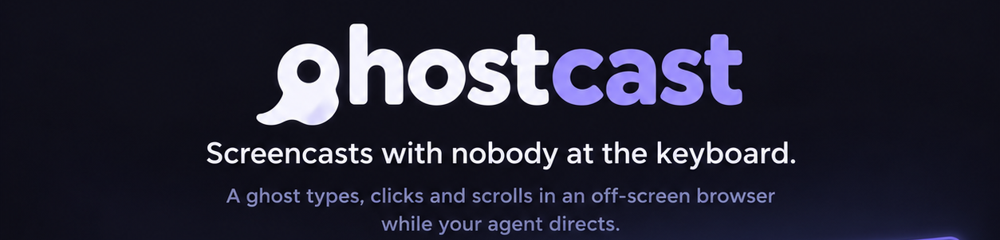
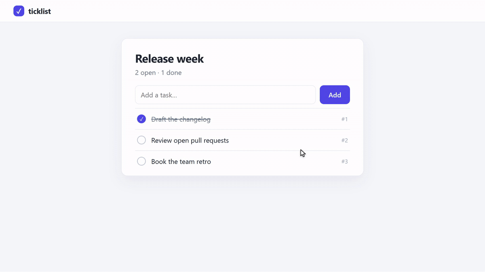

<h1 align="center">
  
</h1>

<p align="center">
  <a href="https://github.com/Sampriti2803/ghostcast/actions/workflows/ci.yml"></a>
  
  
  <a href="LICENSE"></a>
</p>

<p align="center">
  
</p>
<p align="center">
  <sub>Filmed from <a href="#a-planned-video">the storyboard below</a>: a web app, a real terminal
  and VS Code, all working on a disposable copy of the project. No sleeps, zooms or timestamps
  were written.</sub>
</p>

ghostcast drives real terminals, editors and web apps in a headless Chrome, keeps every frame,
and turns them into a finished video: cut to the beats, framed on what matters, timed to the
narration and checked before anyone watches it. Nothing on your screen is recorded or touched,
and every shoot runs in a disposable copy of your project.

> [!NOTE]
> **Pre-release (0.1).** Quick shoots, storyboards, the automatic camera and timing, and the
> checks work today on Windows, macOS and Linux. Built-in speech, output presets and the engine
> interface are next: see the [roadmap](#roadmap). ghostcast is not on npm yet; install it from
> source.

## Contents

- [Why ghostcast](#why-ghostcast)
- [Install](#install)
- [Quick start](#quick-start)
- [A planned video](#a-planned-video)
- [How it works](#how-it-works)
- [Commands](#commands)
- [Documentation](#documentation)
- [Roadmap](#roadmap)
- [Contributing](#contributing)
- [Related tools](#related-tools)
- [License](#license)

## Why ghostcast

Plenty of tools make videos with agents now. Most film a web app and narrate it with generated
speech; some draw terminals instead of filming them, or rebuild the product's UI in code.
ghostcast is for videos of software as it really runs.

- **Real software, filmed as pixels.** Terminal scenes run a real shell in xterm.js; editor
  scenes run VS Code in the browser; web scenes are your app or any site. Commands are typed at a
  human pace, checked on screen before Enter, and waited on until the prompt returns. Agent CLIs
  can run on camera. Nothing is drawn or rebuilt.
- **In the background.** Everything is captured from a headless browser, so you keep working
  while it shoots. Heavy work runs at low priority.
- **Your work is never touched.** Each shoot and rehearsal runs in a disposable copy of the
  project, with its own services, ports and browser profile. The source is fingerprinted before
  and after, and a shoot fails if it changed.
- **Directed from intent.** A storyboard says what to do and what the viewer must see. The camera
  frames the text it reads from the page (a terminal row, an editor line, a button), and each
  beat is fitted to its line: still holds shorten first, then moves play faster.
- **Honest by design.** Everything shown really runs. Every sped-up stretch is tagged `N×` on
  screen. Checks report small text, overlong holds, near-empty frames, secrets on screen and
  misplaced narration, and an agent's description of a beat must quote text that was really on
  the page.
- **Agents review their own footage.** Contact sheets and stills are images an agent can look
  at, and a failed take leaves a screenshot of where it stopped.

## Install

Requirements:

- Node 20 or newer, and Google Chrome (or Edge, via `browser.channel`).
- ffmpeg on `PATH`.
- Bash for terminal scenes: Git Bash on Windows, `/bin/bash` on macOS and Linux.
- The `code` CLI, only for editor scenes.

Until the first npm release, install from source:

```bash
git clone https://github.com/Sampriti2803/ghostcast.git
cd ghostcast
npm install
npm link            # puts `ghostcast` on your PATH
ghostcast doctor    # checks Node, Chrome, ffmpeg, bash and the VS Code CLI
```

Once it is published, `npx ghostcast` will replace these steps.

## Quick start

From the directory you want to film:

```bash
ghostcast shoot "npm test"
ghostcast shoot https://example.com
```

Each quick shoot writes a 1080p `<name>.mp4` and a looping `<name>.gif` (under 10 MB, for a
README) in the current directory. A command runs in a disposable copy of that directory, and its
exit code is reported even when it fails. No project files are needed.

| Option | |
|---|---|
| `--in <dir>` | Film a command in another directory |
| `--out <file>` | Name the outputs |
| `--timeout <seconds>` | Cap how long a command may run |
| `--keep` | Keep the temporary project for inspection |

## A planned video

For a how-to, a feature or a launch, the plan lives in `.ghostcast/` next to the code it shows.
A storyboard is a list of beats: what to do, what the viewer must see, and what is said. This is
the one that made the video at the top, for ticklist, a small task tracker in
[`demo/ticklist/`](demo/ticklist):

```yaml
# .ghostcast/storyboard.yaml
video: ticklist-tour
type: feature
beats:
  - id: add
    surface: web
    open: /
    claim: Tasks are added in the web app.
    do:
      - fill: { New task: Write the release notes }
      - click: Add
    show: text "Write the release notes"
    say: ticklist keeps a team's tasks. Add one in the web app and it joins the list as number four.

  - id: finish
    surface: terminal
    claim: The command line works on the same list.
    do:
      - run: ticklist done 4
    show: 'row "Done: Write the release notes"'
    say: The command line works on the same list, so you can finish it from the terminal.

  - id: file
    surface: editor
    open: tasks.json
    claim: The list is one plain JSON file.
    show: line "Write the release notes"
    say: Underneath, it is one plain JSON file, a task per line.
```

Its `world.yaml` starts the web app in each copy and seeds the tasks; run `ghostcast next` in
`demo/ticklist` to film it yourself.

`ghostcast next` says where the video stands and the one thing to do next. The whole loop:

```bash
ghostcast init                # adds .ghostcast/: product.md, brief.md, world.yaml, audio.yaml
ghostcast next                # where the video stands, and the next action
ghostcast template how-to     # a storyboard skeleton: launch, how-to, feature or receipt
ghostcast lint                # one claim per beat, word budgets, panel share, the length cap
ghostcast rehearse            # every beat three times, unfilmed; flaky beats reported
ghostcast approve storyboard  # once the user has approved the rehearsed plan
ghostcast all                 # film, cut, assemble and check
ghostcast review beats        # a sheet of stills per beat, to look at
ghostcast confirm <beat> "…"  # what the beat shows, quoting on-screen text; checked against the page
```

Editor beats need VS Code in the browser: read the
[VS Code Server license](https://aka.ms/vscode-server-license), then run
`ghostcast vscode --accept-server-license-terms` and wait for "VS Code is ready".

> [!TIP]
> **For agents:** load [`SKILL.md`](SKILL.md). It has the workflow, the storyboard format and the
> rules: honest timing, nothing faked, no personal data, only the user approves, and ask before
> costly or outward-facing steps.

### Beyond the storyboard

A beat the storyboard can't express can point at a code scene, and `ghostcast init <dir>` makes a
sample project of hand-written scenes. They use the engine the storyboard compiles to,
documented in [`docs/scene-api.md`](docs/scene-api.md):

```js
// scenes/build.mjs
export async function setup(h) {
  await h.terminal.open(h.world?.dir || 'workspace');
}

export default async function (h) {
  await h.seg('build_run', async () => {
    await h.run('npm test');
    await h.focusTerm('passing', { rows: 2 });
    await h.sleep(2000);
    h.unfocus();
  });
  await h.seg('build_publish@fit3', () => h.run('npm pack'));
}
```

## How it works

```
storyboard.yaml ──compile──▶ scene ──record──▶ raw/<take>/  frames + event log
                                                   │
                                                   │  cut: fit each beat to its line, ease the camera,
                                                   ▼       render cached beats with speed tags
                                               clips/<take>.mp4
                                                   │
                                                   │  assemble: join by stream copy, cap check, cue sheet
                                                   ▼
                                               out/<name>-silent.mp4 ──check──▶ out/check-report.md
                                                   │
                                                   │  vo-mix: place voice clips by beat, −16 LUFS
                                                   ▼
                                               out/<name>.mp4
```

- **Capture.** Playwright drives Chrome headless, and a CDP screencast keeps every frame, at
  twice the viewport's pixel density by default. The page logs what happened and where (each command, each
  click, the rectangle of each target), so post-production knows the page without reading pixels.
- **Isolation.** `.ghostcast/world.yaml` says how to make the copy: a snapshot of the working
  tree or a chosen commit, files to copy in, setup commands, and services with their own ports.
- **Post-production.** It is deterministic, and the edit is data (`timeline.json`,
  `voiceover/plan.json`), not a timeline in a video editor. Beats are rendered once and cached;
  changing a line re-fits the cut without a re-shoot, and a retake is one command.

Recording real tools without a screen has sharp edges: frames that stop arriving, keystrokes
that vanish, terminals that ignore synthetic input. [`docs/gotchas.md`](docs/gotchas.md) explains
how ghostcast handles each one.

## Commands

`--project <dir>` picks the project (by default `./.ghostcast` when it exists, else the current
directory). `ghostcast --help` lists every option.

**Quick shoots**

| Command | |
|---|---|
| `ghostcast shoot <command\|url>` | Film one command or page into an MP4 and a GIF, with no project |
| `ghostcast doctor` | Check the toolchain |

**The studio**

| Command | |
|---|---|
| `ghostcast init` | Add `.ghostcast/` to this repository |
| `ghostcast next [--json]` | Where the video stands, and the next action |
| `ghostcast template <type> [--force]` | Storyboard skeleton: launch, how-to, feature or receipt |
| `ghostcast lint [--json]` | Check the plan files and estimate each beat against the cap |
| `ghostcast rehearse [beat…] [--runs 3] [--headed]` | Dry-run beats without filming; flaky beats reported |
| `ghostcast approve storyboard` | Record the user's approval against the storyboard's hash |
| `ghostcast check [--report file] [--json]` | Check the cut: text size, holds, captions, empty frames, secrets, voice placement |
| `ghostcast confirm <beat> "…"` | Record what a beat shows; quoted text must be on the recorded page |
| `ghostcast vscode [--port 8765] --accept-server-license-terms` | Serve VS Code in the browser for editor beats |

**The engine**

| Command | |
|---|---|
| `ghostcast init <dir>` | A sample project of hand-written code scenes |
| `ghostcast compile` | Storyboard → generated scene and timeline (`record` and `all` do this first) |
| `ghostcast record <take> [--headed] [--keep-world]` | Run a scene and capture it in an isolated world |
| `ghostcast cut <take…>` | Frames → cached beats and a clip: segments, speed, camera |
| `ghostcast assemble` | Cached beats → silent cut by stream copy, with a cue sheet |
| `ghostcast all [take…] [--keep-world]` | Record and cut each take in one shared world, then assemble and check |
| `ghostcast review <take\|final\|beats> [--raw] [--at s]` | Contact sheets and stills |

**Voice-over**

| Command | |
|---|---|
| `ghostcast vo-script` | Narration timed against the cut, with fit warnings |
| `ghostcast pauses <audio…>` | Where to split recorded clips |
| `ghostcast vo-mix [--plan file]` | Lay the voice-over → final video and a placement report |

## Documentation

| | |
|---|---|
| [`SKILL.md`](SKILL.md) | The agent workflow, the storyboard format, worlds, audio and rules |
| [`docs/scene-api.md`](docs/scene-api.md) | The engine: code scenes and their helpers |
| [`docs/gotchas.md`](docs/gotchas.md) | The capture problems ghostcast works around, and how |
| [`VISION.md`](VISION.md) | Where ghostcast is going, and why |
| [`PLAN.md`](PLAN.md) | The stages toward version 1, with progress and decisions |
| [`demo/ticklist/`](demo/ticklist) | The project filmed for the video above, with its whole plan |
| [`docs/bakeoff.md`](docs/bakeoff.md) | One developer-tool story filmed by several agent video tools |
| [`test/README.md`](test/README.md) | The test suite and its vectors |

## Roadmap

ghostcast is growing into two things: **a studio** for videos of developer tools, driven by the
coding agent you already use, and **an engine** that other video pipelines call when they need
real footage of real software. [VISION.md](VISION.md) has the details, and [PLAN.md](PLAN.md)
the stages.

| | |
|---|---|
| **Done** | One-command install and quick shoots (a first clip in under a minute on each OS, timed in CI); isolation; the studio plan and `ghostcast next`; automatic camera and timing; checks and confirmations |
| **Next** | Voice from any source, fitted by beat: Kokoro locally by default, ElevenLabs with your own key, or your own recordings |
| **Then** | Output presets for GitHub, social feeds, YouTube and submissions, with narration as captions; a JSON interface for other pipelines; version 1 on npm |

## Contributing

Issues and pull requests are welcome. To work on ghostcast:

```bash
npm install
npm test             # everything, including real headless shoots (needs Chrome and ffmpeg)
npm run test:unit    # the faster subset: post-production, worlds, the studio and checks
```

CI runs the whole suite on Windows, macOS and Ubuntu. When a rule changes or a bug is fixed, add
a case to [`test/vectors/`](test/vectors); when you work around a capture problem, add it to
[`docs/gotchas.md`](docs/gotchas.md).

ghostcast builds on [Playwright](https://playwright.dev), [xterm.js](https://xtermjs.org),
[node-pty](https://github.com/microsoft/node-pty), [ffmpeg](https://ffmpeg.org) and
[VS Code in the browser](https://code.visualstudio.com/docs/remote/vscode-server).

## Related tools

If your video is a different kind, one of these may fit better:

- **Many kinds of video from one agent-driven pipeline:**
  [OpenMontage](https://github.com/calesthio/OpenMontage), with a screen-demo pipeline among
  many others.
- **A web app, narrated by generated speech:**
  [openvidstudio](https://github.com/AnayDhawan/openvidstudio),
  [aidemo](https://aidemo.top/),
  [reelson](https://github.com/reelson/reelson),
  [agent-demo-video](https://github.com/OrionArchitekton/agent-demo-video) and
  [screencli](https://screencli.sh).
- **The product's UI rebuilt as animation:**
  [agentic-product-demo](https://github.com/Alexwtlf/agentic-product-demo).
- **Recording yourself, polished automatically:**
  [OpenScreen](https://github.com/getopenscreen/openscreen) and
  [Screen Studio](https://screen.studio).
- **Terminal only:** [VHS](https://github.com/charmbracelet/vhs).
- **Motion graphics written as code:**
  [HyperFrames](https://github.com/heygen-com/hyperframes) and
  [Remotion](https://www.remotion.dev).

## License

[MIT](LICENSE)
