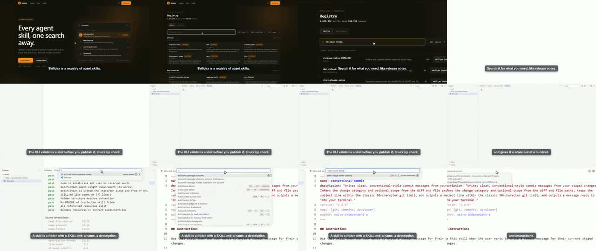
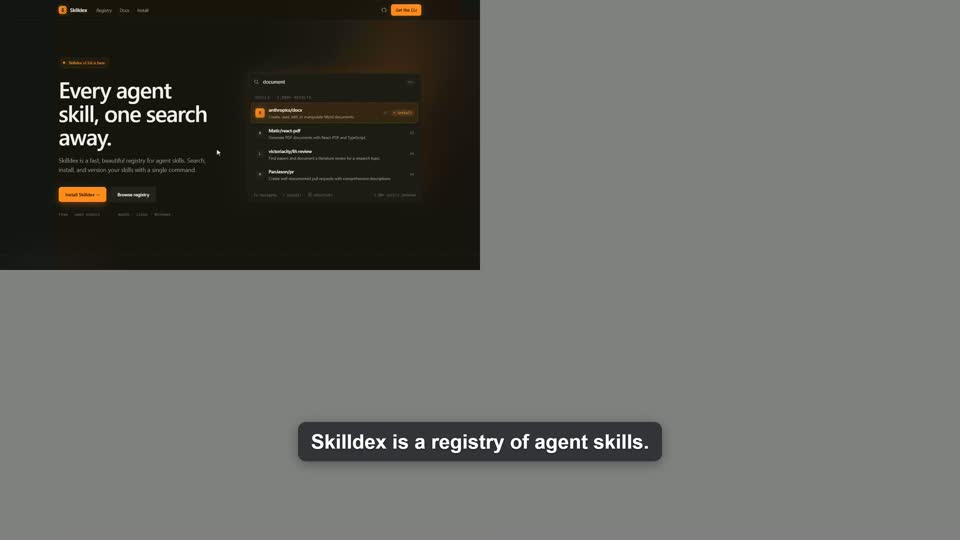
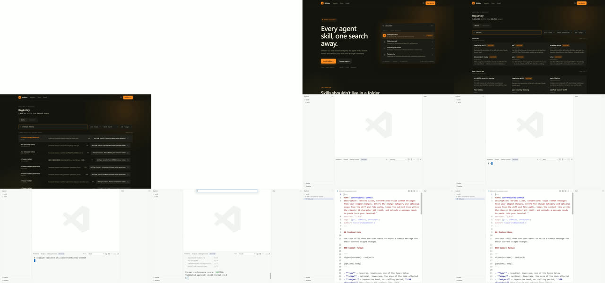
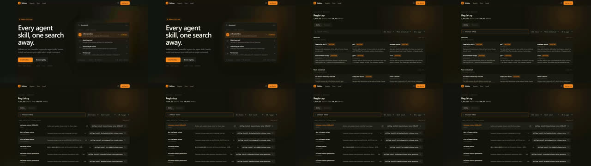
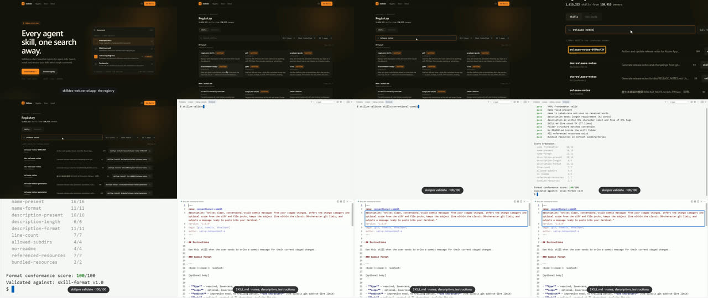

# Bake-off: the Skilldex story

*27 September 2026. Stage 0 of [PLAN.md](../PLAN.md): what other agent video tools can film of a
real developer-tool story, what it takes, and where ghostcast 0.1 stands.*

## The story

Three beats from the Skilldex demo, one surface each:

| Beat | Surface | What happens | Narration |
|---|---|---|---|
| Registry | Web (the public site, read only) | Home page → *Browse registry* → type "release notes" → the first result | "Skilldex is a registry of agent skills. Search it for what you need, like release notes." |
| Validate | Terminal | `skillpm validate skills/conventional-commit` → its checks and "100/100" | "The CLI validates a skill before you publish it, check by check, and gives it a score out of a hundred." |
| Skill file | Editor | Open the skill's `SKILL.md`, show its description | "A skill is a folder with a SKILL.md: a name, a description, and instructions." |

The terminal and editor beats ran against a copy of one skill in a scratch folder. The web-only
tools were pointed at the same VS Code in the browser (`code serve-web`) that ghostcast uses, to
test whether a browser recorder can film a terminal and an editor once it's given one.

## How it was run

- One machine: Windows 11, Intel i7-11800H (8 cores, 16 threads), 32 GB, Node 22.22, ffmpeg 8.1,
  Chrome. One agent (Claude Code) authored every tool's script; no human edits.
- Each tool was installed into its own folder, with install scripts inspected first and skipped
  where binaries were already present, and run with every API key and agent-session variable
  removed from its environment. Nothing paid was called.
- Narration: aidemo's local Kokoro voice. ghostcast 0.1 has no speech generation, so it laid the
  same Kokoro clips as its "recorded" voice-over: the same words and voice in both cuts.
- Viewport: 1440×810 CSS pixels. aidemo's lint warns that at 1920 CSS pixels a site's body text
  ends up about 14 px after downscaling; ghostcast followed the same advice (at `dpr` 2).
- **Bias to keep in mind:** the author knows ghostcast's code, and what aidemo's failures taught
  (VS Code's trust dialog, its button markup) went into reelson's script, which then worked first
  time.

## Results

| Tool | Version | Registry | Validate | Skill file | Finished video | Runs to a usable result |
|---|---|---|---|---|---|---|
| ghostcast | 0.1 (c0c4aee) | ✓ | ✓ | ✓ | ✓ 25.0 s, 1080p30, −16.0 LUFS, voice on its beats | 2 |
| aidemo | 0.15.2 | ✓ | ✓ but the payoff was cut | ✓ | ✓ 19.5 s, 1440×810, −23 LUFS, captions burned in | 5 |
| reelson | 0.9.0 | ✓ | ✓ | ✓ | ✗ raw recording only: composition fails on Windows | 1 (with the lessons above) |
| openvidstudio | mcp-server 0.1.0 | ✓ raw capture | ✗ can't type or press keys | ✗ | not attempted (writes a Remotion project) | 1 capture |

### aidemo

The most complete of the others by far:
- lint that predicts pacing and legibility before recording;
- `inspect` for real selectors, a probe (dry run) and a QA report;
- per-scene voice caching (unchanged scenes were never re-voiced);
- local Kokoro narration and offline captions;
- auto-zoom, spotlight and callouts, keystroke overlays, variants, multi-language renders, and a
  "demo as regression test" mode.

Its registry beat looks polished. What went wrong:

- **Windows.** It computes its install folder as `C:\C:\…`, so every browser command fails until
  `AIDEMO_CHROME_PROFILE` is set. With `deviceScaleFactor: 2` (which its lint recommends) the
  page filled only the top-left quarter of every frame:

  

- **VS Code.** Its terminal beat failed three times before working: the workspace-trust dialog
  blocks the terminal, appears late, and its buttons aren't `<button>` elements.
- **Fitting cut the claim.** Compose fits each scene to its narration: speed up to 2×, then cut
  the tail. The validate scene ran long, so its tail was cut, and that tail was the score. The
  narrator says "gives it a score out of a hundred" over an empty prompt; the output appears in
  the next scene. The only trace is a warning in the compose log.
- **Unmarked speed-ups.** Scenes played at 1.3×, 1.6× and 2× with nothing on screen saying so.
- **Loudness.** −23 LUFS without a music bed; web platforms expect about −16.

### reelson

- Playwright-based TypeScript scenarios with human-paced helpers, Chrome's screencast (correct at
  2×, unlike aidemo's), desktop, phone and square takes, CI re-recording, and `publish` to
  channels.
- **Its compose step can't run on Windows:** it starts HyperFrames with `spawnSync('npx', …)`
  and no shell, which fails for `npx.cmd`. Without it there are no zooms, captions or voice, only
  38 s of real-time footage: a white loading frame, about 6 s of VS Code's splash, and VS Code's
  default layout (Explorer and a Chat panel) with small terminal text.
- Its own doctor warns that its screencast reaches only 29 fps on this machine.

### openvidstudio

- The npm package exposes 14 MCP tools, not the 31 its README describes; there is no terminal
  capture in it.
- Its recorder does `click`, `fill`, `select`, `hover`, `scroll` and `wait`, with no typing or
  key presses, so it can't drive a terminal even in the browser. The search text appears at once,
  and there is no cursor.
- It writes a Remotion project into the repository and renders through Remotion, so a company of
  four or more people needs Remotion's paid license. Its `terminal` scene template draws a
  terminal rather than filming one.

### ghostcast 0.1

- All three beats, from real software, with the drawn cursor, typing at a human pace, a clean
  VS Code layout (no side bars, cleared terminal), eased zooms, marks and captions.
- **The claim is on screen when it's said:** the zoom sits on "Format conformance score:
  100/100" while the narrator says it. The voice-over was placed by beat with no problems;
  loudness −16.0 LUFS.
- **What it took:** a second run.
  - `h.focus` and `h.mark` don't accept a Playwright locator, though `h.point` and `h.tap` do.
  - The skill-file take was shorter than its line, so its hold was lengthened by hand. Stage 5
    exists to remove exactly that.
- **Weak spots:** the terminal beat opens on a mostly empty frame before the zoom, and a
  full-width text block barely zooms.

## ghostcast baselines

Wall time and total CPU (sampled every second; the machine sat at 13% idle):

| Phase | Wall time | CPU average | CPU peak |
|---|---|---|---|
| Record a take (includes opening VS Code off camera) | 15–22 s | 36–46% | 78% |
| Cut | 1.6–2.7 s per second of output (26 s for a 9.5 s clip) | 24–31% | 55% |
| Assemble (25 s, captions) | 7.9 s | 70% | 87% |
| Voice-over mix | 2.6 s | 26% | 31% |
| Review sheet | 4.1 s | 37% | 40% |

At these rates the 145 s Skilldex video needs four to six minutes to cut, and assembling takes
most of a 16-thread machine while it runs.

## What it changes in the plan

- **The difference is real, and narrower than "only ghostcast reaches a terminal".** A browser
  recorder can film VS Code in the browser. What it lacks is what ghostcast already does: getting
  past trust dialogs and layout, typing that is confirmed on screen, waiting for the prompt, and a
  clean shell. And no other tool refused to cut the claim to fit the voice. Stage 5's fitting
  order (shorten still holds, then speed up moves, never cut into one) and stage 6's check that
  the `show` target is visible while it is said are the right bets; aidemo shows the failure they
  prevent.
- **Web polish is crowded.** aidemo already has lint, QA, inspect, variants and more. ghostcast
  shouldn't compete feature for feature on the web; its planning lint can learn from aidemo's
  (pacing prediction, legibility, missing waits).
- **Stage 1:**
  - make 1440 CSS pixels at `dpr` 2 the default viewport;
  - set a target of at most 0.5 s of cutting per output second;
  - render at low priority, since assembling alone took 70% of a 16-thread machine.
- **Stage 7:** Kokoro through `kokoro-js` pulls in about 400 MB of dependencies (onnxruntime,
  sharp, transformers) plus a 90 MB model. It has to be installed on demand, not bundled.
- **Windows reliability is a differentiator.** Two of the three other tools broke on Windows out
  of the box. Keep all three operating systems in the smoke test from stage 1 on.
- **Small fix:** `h.focus` and `h.mark` should accept locators like `h.point` and `h.tap`.

## Caveats

- One story, one machine, one agent, one day; each tool as published on 27 September 2026.
- The web beat used the public Skilldex site, read only: a few page loads, as any visitor.
- ghostcast's run used 0.1 as committed, plus uncommitted edits in the working tree to
  `py/cut.py`, `src/driver.js` and `src/recorder.mjs` (a `speeds` setting and new mark shapes)
  that the story didn't use.
- Found afterwards: ghostcast's capture in this run was not oversampled. Chrome's screencast sent
  frames at the page's CSS size (1440×810), so ghostcast's 1080p cut was upscaled and its zooms were
  softer than they should have been. The recorder now runs Chrome at the device scale, which gives
  true 2880×1620 frames.
